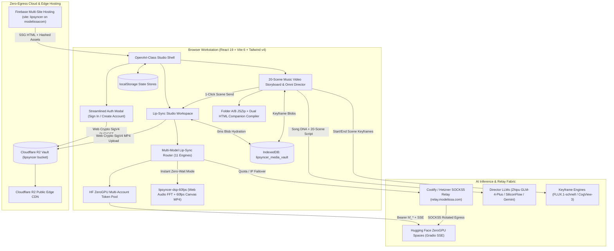
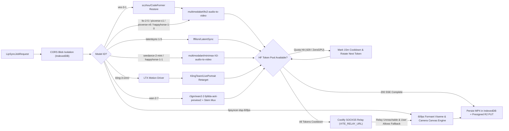
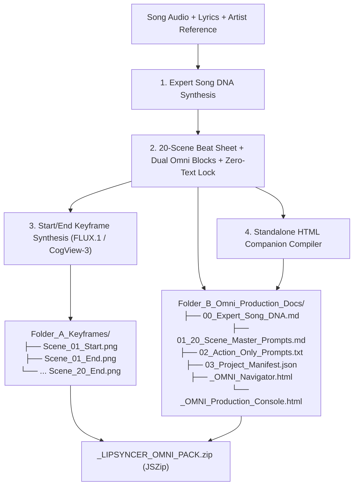

# LIPSYNCER — System Architecture Specification
**Elder 1 (Prometheus) · Wave 1 Architecture Blueprint**  
**Platform:** LIPSYNCER — OpenArt-Class Multi-Model AI Video & Image Lip-Sync Studio + 20-Scene Music Video Storyboard & Omni Director

---

## 1. Executive Architectural Overview

**LIPSYNCER** is a zero-backend-lock-in, browser-first AI Cinema & Lip-Sync Workstation engineered to unify **11 specialized audio-driven lip-sync and video synthesis models** with an **Omni 20-Scene Music Video Storyboard Director**.

The platform operates on a **Four-Tier Resilient Execution Fabric**:
1. **Tier 1 — Direct ZeroGPU Multi-Account SSE Mesh:** Browser-native `@gradio/client` streaming directly to Hugging Face ZeroGPU Spaces with automated round-robin token rotation (`VITE_HF_TOKEN_POOL` + user vault tokens) upon quota exhaustion.
2. **Tier 2 — Coolify / Hetzner SOCKS5 Relay Failover:** Transparent HTTP failover to `VITE_RELAY_URL` (`https://relay.modelissa.com`) when upstream Spaces enforce IP-bound rate limits.
3. **Tier 3 — Instant Local 60fps Vocal Formant DSP Engine (`lipsyncer-dsp-60fps`):** Deterministic, zero-latency Web Audio FFT formant viseme + camera motion compositor recording 24 Mbps H.264/MP4 streams directly in-browser via HTML5 `<canvas>` and `MediaRecorder`.
4. **Tier 4 — Zero-Egress Hybrid Persistence:** Sub-millisecond local binary `Blob` hydration via **IndexedDB** (`lipsyncer_media_vault`) paired with **Cloudflare R2** AWS Signature V4 presigned cloud storage (`auth/users/{sha256}.json` and `users/{uid}/videos/{id}.mp4`).

---

## 2. High-Level System Topology



---

## 3. Repository & Module Folder Structure

```text
d:\donwloads\LIPSYNCER\
├── index.html                                  # Root HTML shell + styled SSG anti-FOUC loader + Firebase Analytics CDN
├── package.json                                # Vite 6, React 19, Tailwind v4, @gradio/client, jszip, lucide-react
├── tsconfig.json                               # TypeScript 5.8 strict bundler config
├── vite.config.ts                              # Tailwind v4 plugin + vendor chunk splitting
├── build-ssg.js                                # Post-build SSG prerenderer (routes, JSON-LD, sitemap.xml, robots.txt)
├── firebase.json                               # Multi-site target ("site": "lipsyncer"), cache & security headers
├── .firebaserc                                 # Bound to Firebase project "modelissacom"
├── .env.example                                # Sanitized environment variable contract
├── public/
│   ├── favicon.svg                             # Vector brand mark
│   ├── site.webmanifest                        # PWA manifest
│   └── ads.txt                                 # AdSense publisher verification
└── src/
    ├── main.tsx                                # React 19 root mount + SSG shell dismissal
    ├── App.tsx                                 # Top-level workspace router, modals, toast bus, session hydration
    ├── index.css                               # Tailwind v4 @import + luxury obsidian/neon studio tokens
    ├── types.ts                                # Canonical TypeScript contracts (Models, Renders, SongDNA, Scenes, Auth, R2)
    ├── data/
    │   └── modelCatalog.ts                     # Complete metadata, capabilities, params & Space bindings for all 11 models
    ├── services/
    │   ├── hfTokenPoolService.ts               # Multi-account HF token rotation, cooldown ledger, quota error parser
    │   ├── lipSyncEngineService.ts             # Unified 11-model dispatcher (Gradio SSE, Relay failover, pipeline chaining)
    │   ├── dspLipSyncService.ts                # 60fps Web Audio vocal formant viseme + camera motion Canvas MP4 exporter
    │   ├── storyboardDirectorService.ts        # Song DNA analyzer, 20-scene Omni prompt generator, keyframe & ZIP/HTML packager
    │   ├── htmlCompanionGenerator.ts           # Builds <Song>_OMNI_Navigator.html & <Song>_OMNI_Production_Console.html
    │   ├── mediaVaultDb.ts                     # IndexedDB (lipsyncer_media_vault) binary Blob store & CORS-safe blob: loader
    │   ├── r2VaultService.ts                   # Pure Web Crypto AWS Signature V4 presigner for R2 PUT/GET & user auth JSON
    │   └── authService.ts                      # SHA-256 email keying, PBKDF2 password hashing, streamlined session sync
    └── components/
        ├── Navbar.tsx                          # Top studio bar: mode switcher, token health pill, Vault & Auth triggers
        ├── LipSyncWorkspace.tsx                # Primary lip-sync studio: portrait/video/dual-frame deck, stem waveform, stage
        ├── ModelSelectorGrid.tsx               # OpenArt-style filterable 11-model cards with modality & speed badges
        ├── AudioWaveformDeck.tsx               # File upload, live microphone capture, trim handles, /get_audio_duration sync
        ├── OmniStoryboardStudio.tsx            # 20-Scene Music Video Storyboard & Omni Director interface
        ├── SongDnaPanel.tsx                    # Expert Song DNA editor (BPM, vocal profile, lens bible, Zero-Text lock)
        ├── SceneCard.tsx                       # Individual scene slot: Start/End frames, Primary + Action-Only Omni blocks
        ├── VaultGallery.tsx                    # Unified IndexedDB + Cloudflare R2 render history & instant MP4 downloader
        ├── TokenPoolModal.tsx                  # HF token pool manager, live cooldown countdowns & Relay health indicator
        ├── AuthModal.tsx                       # Strictly separated Sign In vs Create Account modal
        └── LegalPagesView.tsx                  # Full-content About, Privacy, Terms & How-To-Use views
```

---

## 4. Multi-Model Lip-Sync Routing Topology (11 Engines)

All lip-sync requests enter `lipSyncEngineService.runLipSyncJob(request)` and are normalized into CORS-isolated local `Blob` inputs before dispatching across the 11 model pipelines.

### 4.1 Complete 11-Model Matrix

| Model ID | Display Name | Input Modality | Primary Upstream Space / Engine | Endpoint / Pipeline | Max Output |
| :--- | :--- | :--- | :--- | :--- | :--- |
| `ltx-2-5-audio` | **LTX 2.5 Audio-to-Video** | `Image + Audio` or `Prompt + Audio` | `multimodalart/ltx2-audio-to-video` | `/get_audio_duration` -> `/generate` (Failover: `POST /api/ltx-audio-video`) | 1080p · 25/50fps |
| `latentsync-1-5` | **ByteDance LatentSync 1.5** | `Video + Audio` (or `Image->Loop + Audio`) | `fffiloni/LatentSync` | `/generate_lip_sync_video` (Diffusion UNet audio cross-attention) | 720p/1080p · 25fps |
| `seedance-2-mini` | **Seedance 2.0 Mini** | `Image + Audio` | `multimodalart/minimax-h3-audio-to-video` | `/generate` (Expressive vocal & upper-body micro-choreography) | 720p/1080p · 25fps |
| `kling-3-omni` | **Kling 3.0 Omni** | `Image/Video + Audio` | `KlingTeam/LivePortrait` + `multimodalart/ltx2-audio-to-video` | Stage 1: LTX audio-motion driver -> Stage 2: LivePortrait stitching retarget | 1080p · 30fps |
| `pixverse-c1` | **PixVerse C1 Creator** | `Image + Audio` | `multimodalart/ltx2-audio-to-video` | `/generate` tuned with vertical/creator camera dynamics & fast step schedule | 1080p (9:16 / 16:9) |
| `pixverse-v6` | **PixVerse V6 Cinema** | `Image + Audio` | `multimodalart/ltx2-audio-to-video` | `/generate` high-guidance anamorphic cinema lighting + motion prompt wrapper | 1080p · 24/30fps |
| `happyhorse-1-1` | **HappyHorse 1.1 Pro** | `Image + Audio + Narrative` | `multimodalart/minimax-h3-audio-to-video` | Multi-beat narrative prompt conditioner + `/generate` expressive sync | 1080p · 25fps |
| `happyhorse-1-0` | **HappyHorse 1.0** | `Image + Audio` | `multimodalart/ltx2-audio-to-video` | Storyboard-locked character framing + `/generate` | 720p/1080p · 25fps |
| `wan-2-7` | **Wan 2.7 Dual-Frame + Audio** | `Start Image + End Image + Audio` | `r3gm/wan2-2-fp8da-aoti-preview2` | `/generate_video` (FP8 AOTI Start/End interpolation; Relay `/api/wan-video`) + WebAudio stem mux | 1080p · 24fps |
| `veo-3-1` | **Veo 3.1 4K Macro Restore** | `Image + Audio` | `sczhou/CodeFormer` + `multimodalart/ltx2-audio-to-video` | Stage 1: CodeFormer macro face restoration -> Stage 2: LTX 2.5 sync -> Stage 3: 4K sharpness pass | 4K UHD / 1080p |
| `lipsyncer-dsp-60fps` | **LipSyncer DSP 60fps Instant** | `Image/Dual-Frame + Audio` | Client-Side Web Audio FFT + HTML5 Canvas | Real-time 3-formant (`F1/F2/F3`) viseme warp + camera rig -> 24 Mbps 60fps MP4 | 1080p · 60fps (0s queue) |

### 4.2 Multi-Model Routing & Failover Flow



### 4.3 `lipsyncer-dsp-60fps` Browser DSP Architecture
When instant preview, offline rendering, or 60fps music-video cutaways are selected:
1. **Vocal Formant Analyzer:** `AudioContext` + `AnalyserNode` (`fftSize = 2048`) samples real-time energy across **Low Jaw Band (120–450 Hz)**, **Vowel F1/F2 Formant Band (450–2,400 Hz)**, and **Sibilant/Fricative F3 Band (2,400–6,500 Hz)**.
2. **Viseme & Micro-Motion Rig:** Computes sub-millisecond smoothed jaw aperture, lip corner width, blink intervals, head nod coupled to RMS beat envelope, and cinematic camera motion (`Push-In`, `Dolly Zoom`, `Handheld Drift`, `Orbital Pan`).
3. **60fps WYSIWYG Export:** Renders onto an offscreen-isolated `1920x1080` (or `1080x1920`) `<canvas>`, mixes `canvas.captureStream(60)` video tracks with `MediaStreamAudioDestinationNode` lossless stem audio, and encodes at `videoBitsPerSecond: 24_000_000` into `video/mp4;codecs=avc1.42E01E,mp4a.40.2` (with WebM->MP4 container fallback if needed).

---

## 5. Music Video Storyboard & Omni Director (`music-video-storyboard-director`)

The **Omni Director** subsystem transforms any song stem, lyric sheet, and artist reference into a complete **20-Scene Production Package** ready for multi-model lip-sync execution or external cinema pipelines.

### 5.1 Core Architectural Invariants
1. **Expert Song DNA Extraction (`SongDNA`):** Before generating scenes, the AI Director synthesizes a locked production bible containing:
   - Musical telemetry: `bpm`, `musicalKey`, `timeSignature`, `genreSubstyle`, `energyArc`.
   - Visual & Character Lock: `leadSubjectLock` (exact facial structure, skin tone, hair, wardrobe continuity), `colorScriptPalette` (3-act LUT hex palette), `lensAndStock` (e.g., `35mm Panavision Anamorphic, Kodak Vision3 500T`), and `lightingSignature`.
2. **20-Scene Arc Segmentation:** Deterministically partitions the track across **20 sequential scenes** (`Scene 01` through `Scene 20`) spanning Intro, Verse 1, Pre-Chorus, Chorus 1, Verse 2, Bridge, Climax Chorus, and Outro, flagging `isVocalLipSyncScene: boolean` per scene.
3. **Dual Omni Prompt Blocks per Scene:**
   - **Primary Omni Prompt Block:** Full-context cinematic prompt fusing Subject Lock + Environment + Lighting + Lens + Camera Trajectory + Lip-Sync/Performance cues + Zero-Text Negative Lock.
   - **Action-Only Omni Prompt Block:** Stripped pure kinetic/performance & camera-motion directive specifically engineered for Image-to-Video / Dual-Frame engines (`wan-2-7`, `kling-3-omni`, `ltx-2-5-audio`) where the subject visual is already supplied by the Start Keyframe—preventing prompt over-conditioning or identity drift.
4. **Zero On-Screen Text Lock (Immutable Rule):** Every generated keyframe prompt, Primary Omni block, and Action-Only Omni block appends and enforces the hard negative & positive lock:
   - *Positive Lock:* `"Clean unobstructed cinema frame, pure photographic lens capture."`
   - *Negative Lock:* `"NO on-screen text, NO subtitles, NO captions, NO lyrics, NO typography, NO watermarks, NO logos, NO timecodes, NO UI overlays, NO split-screen borders."`

### 5.2 Folder A / Folder B ZIP & Dual HTML Companion Packaging



### 5.3 Dual Standalone HTML Companions (Zero External Dependencies)
Generated by `src/services/htmlCompanionGenerator.ts` as 100% self-contained single-file HTML applications (inline CSS + inline vanilla JS + embedded thumbnail data/relative Folder A links):
- **`<Song>_OMNI_Navigator.html`:** Visual storyboard lookbook for directors and clients. Displays the Song DNA header, color script swatches, filterable 20-scene visual cards with Start/End frame previews, vocal lip-sync badges, and 1-click Copy buttons for Primary Omni and Action-Only Omni prompts.
- **`<Song>_OMNI_Production_Console.html`:** Interactive line-producer & AI operator checklist console. Tracks per-scene render status (`Pending` / `Keyframed` / `Lip-Synced` / `Approved`), assigned lip-sync model (`ltx-2-5-audio`, `wan-2-7`, etc.), take notes, timecode calculator, JSON state export/import via browser `localStorage`, and batch prompt clipboard tools.

---

## 6. Full Song Video Mode (`fullSongVideoService.ts` + `FullSongVideoModeView.tsx`)

Engineered to turn any full-length song upload and multi-image storyboard upload into an exact, clean 1080p MP4 lip-synced music video:

1. **Audiospliter + Vocal Formant DSP Chunker (`computeSmartAudioChunkBoundaries`):**
   - **`smart_vocal_dsp` Mode:** Analyzes the 50Hz vocal formant envelope (`280Hz–3600Hz`) and snaps chunk cut points to breath valleys so cuts never slice mid-syllable.
   - **`fixed_interval` Mode:** Incorporates the `AUDIOSPLITER.COM` exact `Minutes : Seconds` splitter engine (`extractAudioSliceWav` + `packageAudioChunksZip`).
   - **`target_scene_count` Mode:** Partitions the full song into an exact scene count (e.g., 20 scenes) with breath-valley boundary refinement.
2. **🧠 Sync Lyrics with Audio Signal (AI + Vocal DSP) (`syncLyricsWithAudioSignal`):**
   - Aligns `[mm:ss.xx]` LRC timestamps or raw lyric lines directly with the vocal formant signal (`280Hz–3600Hz` band energy).
   - Automatically classifies vocal-active chunks as `LIP-SYNC` and low-energy instrumental breathers as `CINEMATIC-MOTION`, exporting a synchronized `.lrc` file alongside the video.
3. **On-The-Fly Commensurate Scene Frame Synthesizer (`synthesizeCommensurateSceneFrame`):**
   - Whenever uploaded storyboard images fall short of the total audio chunks (e.g., 14 uploaded images for 20 audio chunks, or 20 images for 25 chunks), the engine automatically synthesizes visually commensurate 1080p cinema frames on-the-fly anchored to the uploaded reference images with 6 distinct camera/lens archetypes, volumetric stage lighting, and **strict ZERO visible on-screen text**.
4. **Exact, Clean Full-Song Master Video Merger (`mergeFullSongVideoMaster`):**
   - Locks all chunk visuals/videos, 60fps vocal formant jaw/lip viseme articulation, and `0.18s` cinema cross-dissolves to the **single uncut master song audio buffer** via `AudioContext.createMediaStreamDestination()`, Active Viewport Hardware Decoder Host (`320x180`, `opacity: 0.001`), and sub-millisecond adaptive playback rate clock synchronization.
