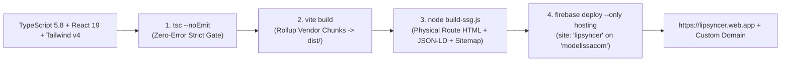

# LIPSYNCER — Build, SSG, Multi-Site Hosting & Relay DevOps Specification
**Elder 5 (Hephaestus) · Wave 1 Infrastructure & Release Pipeline**

---

## 1. End-to-End Build & Release Pipeline



### 1.1 NPM Script Contract (`package.json`)
- **`npm run dev`**: Launches Vite 6 HMR server with `@tailwindcss/vite`.
- **`npm run lint`**: Runs `tsc --noEmit` across `src/` with `"strict": true`.
- **`npm run build`**: Executes `tsc --noEmit && vite build && node build-ssg.js`.
- **`npm run test`**: Executes `vitest run` for unit verification of token rotation, SigV4 signing, Song DNA validation, and 20-scene Zero-Text locks.

### 1.2 Rollup Chunk Strategy (`vite.config.ts`)
Deterministic vendor splitting keeps initial cold load fast and cache-hit ratios high:
- `react-vendor`: `['react', 'react-dom']`
- `icons-vendor`: `['lucide-react']`
- `gradio-vendor`: `['@gradio/client']`
- `zip-vendor`: `['jszip']`

---

## 2. Static Site Generation (`build-ssg.js`) & Production SEO

Running immediately after `vite build`, `build-ssg.js` reads the compiled `dist/index.html` template and emits physical, crawlable `index.html` files for every canonical public route:

| Canonical Route | Physical Output File | Schema.org JSON-LD | Sitemap Priority / Freq |
| :--- | :--- | :--- | :--- |
| `/` | `dist/index.html` | `WebApplication` + `FAQPage` | `1.0` / `weekly` |
| `/omni-director/` | `dist/omni-director/index.html` | `WebApplication` + `BreadcrumbList` | `0.9` / `weekly` |
| `/models/` | `dist/models/index.html` | `CollectionPage` + `BreadcrumbList` | `0.9` / `weekly` |
| `/how-to-use/` | `dist/how-to-use/index.html` | `HowTo` + `BreadcrumbList` | `0.8` / `monthly` |
| `/about/` | `dist/about/index.html` | `AboutPage` + `BreadcrumbList` | `0.6` / `monthly` |
| `/privacy/` | `dist/privacy/index.html` | `WebPage` + `BreadcrumbList` | `0.6` / `monthly` |
| `/terms/` | `dist/terms/index.html` | `WebPage` + `BreadcrumbList` | `0.6` / `monthly` |

### 2.1 SSG Invariants
1. **Domain Consistency:** `BASE_URL` is resolved strictly from `VITE_CANONICAL_URL` (with trailing-slash consistency across `<link rel="canonical">`, `og:url`, JSON-LD `@id`, `dist/sitemap.xml`, and `dist/robots.txt`).
2. **AdSense & Crawler Semantic `<main>`:** Each prerendered route injects real structured HTML documentation inside `<main id="ssg-seo-shell">` styled as a clean obsidian studio pre-hydration shell (dismissed smoothly upon React mount without `display: none` cloaking).
3. **Never Index Admin/Auth Modals:** Only whitelisted `CANONICAL_ROUTES` enter `dist/sitemap.xml`.

---

## 3. Firebase Multi-Site Hosting Targeting (`112` Protocol)

> [!CAUTION]
> **CRITICAL MULTI-SITE SAFETY RULE:** The Firebase project `modelissacom` hosts multiple production applications. LIPSYNCER **MUST** always include `"site": "lipsyncer"` inside `firebase.json` so `modelissacom.web.app` (the root default site) is **NEVER** overwritten.

### 3.1 `.firebaserc` Configuration
```json
{
  "projects": {
    "default": "modelissacom"
  },
  "targets": {
    "modelissacom": {
      "hosting": {
        "lipsyncer": [
          "lipsyncer"
        ]
      }
    }
  }
}
```

### 3.2 `firebase.json` Specification (Anti-Cache HTML + Immutable Assets)
```json
{
  "hosting": {
    "site": "lipsyncer",
    "public": "dist",
    "ignore": [
      "firebase.json",
      "**/.*",
      "**/node_modules/**"
    ],
    "cleanUrls": true,
    "trailingSlash": true,
    "rewrites": [
      {
        "source": "**",
        "destination": "/index.html"
      }
    ],
    "headers": [
      {
        "source": "**/*.@(html|json|xml|txt|webmanifest)",
        "headers": [
          {
            "key": "Cache-Control",
            "value": "no-cache, no-store, must-revalidate"
          }
        ]
      },
      {
        "source": "/",
        "headers": [
          {
            "key": "Cache-Control",
            "value": "no-cache, no-store, must-revalidate"
          }
        ]
      },
      {
        "source": "/assets/**",
        "headers": [
          {
            "key": "Cache-Control",
            "value": "public, max-age=31536000, immutable"
          }
        ]
      },
      {
        "source": "**",
        "headers": [
          {
            "key": "X-Frame-Options",
            "value": "SAMEORIGIN"
          },
          {
            "key": "X-Content-Type-Options",
            "value": "nosniff"
          },
          {
            "key": "Referrer-Policy",
            "value": "strict-origin-when-cross-origin"
          },
          {
            "key": "Permissions-Policy",
            "value": "camera=(self), microphone=(self), geolocation=()"
          }
        ]
      }
    ]
  }
}
```

### 3.3 Verification & Deployment Commands
```powershell
# 1. Verify provisioned hosting sites on modelissacom
firebase hosting:sites:list --project modelissacom

# 2. Provision dedicated site if not yet created
firebase hosting:sites:create lipsyncer --project modelissacom

# 3. Compile TypeScript, bundle Vite chunks, and prerender SSG routes + sitemap
npm run build

# 4. Deploy strictly to dedicated "lipsyncer" hosting site
firebase deploy --only hosting --project modelissacom
```

---

## 4. Coolify / Hetzner SOCKS5 Relay Integration (`relay.modelissa.com`)

To guarantee 99.9% inference completion even when Hugging Face ZeroGPU enforces per-IP limits on browser clients, LIPSYNCER integrates with the self-hosted **Coolify / Hetzner SOCKS5 Video Relay** (`VITE_RELAY_URL=https://relay.modelissa.com`).

### 4.1 Relay Operational Architecture
- **Edge Routing:** Traefik reverse proxy on Hetzner Cloud terminates TLS (`Let's Encrypt`) for `relay.modelissa.com` and forwards multipart upload streams (up to `100 MB` body limit, `300s` read timeout) to the Node.js Express relay container.
- **CORS Preflight Resilience:** The relay explicitly responds `204 No Content` to `OPTIONS` preflights from `https://lipsyncer.web.app`, `https://lipsyncer.firebaseapp.com`, custom domains, and `http://localhost:5173`.
- **SOCKS5 Egress Rotation:** Outbound `@gradio/client` calls from the relay bind through rotated SOCKS5 exit proxies and forward an optional client-supplied `hfToken` header, returning either a zero-egress R2 URL or temporary signed stream URL.
- **Client-Side Circuit Breaker:** On studio boot, `lipSyncEngineService` performs a non-blocking `3,000ms` timeout probe against `${VITE_RELAY_URL}/health`. If offline or unconfigured, LIPSYNCER marks the relay badge as `Standby` and relies seamlessly on Direct Browser Gradio SSE + `lipsyncer-dsp-60fps` without blocking any UI flow.
