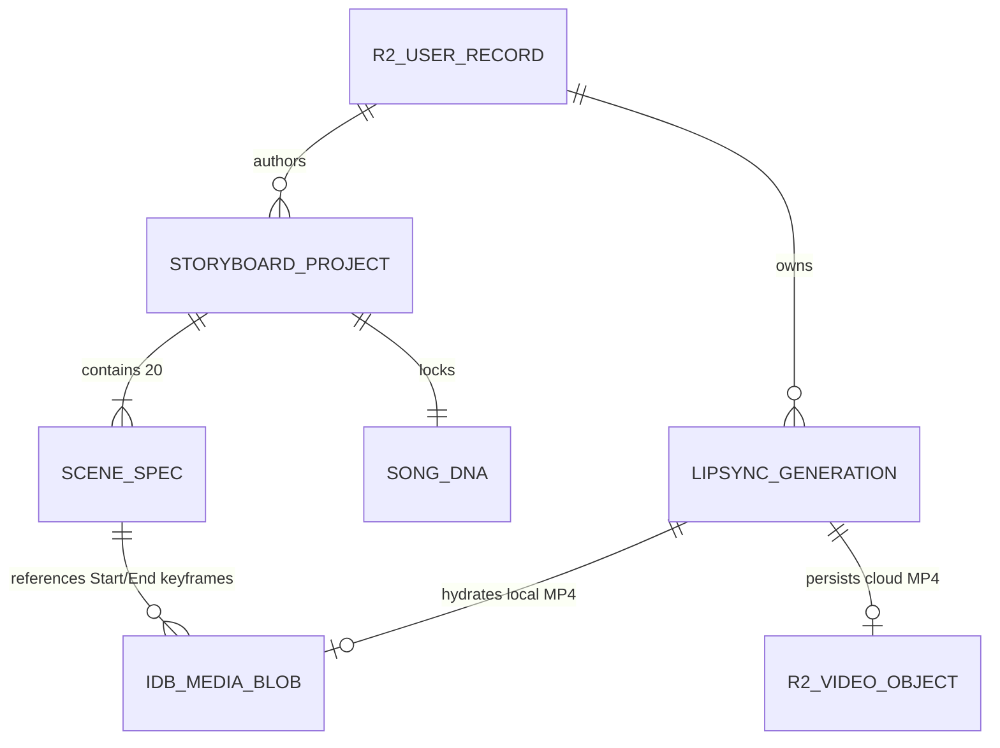

# LIPSYNCER — Data Persistence & Vault Schema Specification
**Elder 2 (Atlas) · Wave 1 Data Architecture Blueprint**

---

## 1. Storage Architecture Overview

LIPSYNCER employs a **Three-Layer Zero-Egress Data Architecture** designed to eliminate cloud bandwidth spikes, survive accidental browser refreshes or mobile tab eviction, and keep multi-megabyte audio/video assets instantaneous:

| Layer | Technology | Database / Bucket Name | Responsibility |
| :--- | :--- | :--- | :--- |
| **Layer 1: Cloud Vault** | Cloudflare R2 (S3-Compatible) | `lipsyncer` (`VITE_R2_BUCKET_NAME`) | Cross-device user identity JSON (`auth/users/{sha256}.json`), permanent MP4 renders (`users/{uid}/videos/{id}.mp4`), and zero-egress CDN playback (`VITE_R2_PUBLIC_URL`). |
| **Layer 2: Local Binary Vault** | Browser IndexedDB | `lipsyncer_media_vault` (v1) | Native binary `Blob` storage for uploaded portraits, videos, audio stems, scene keyframes, and rendered MP4s. Provides 0ms reload hydration and CORS-clean `blob:` URLs. |
| **Layer 3: Reactive Metadata** | Browser `localStorage` | `lipsyncer_*_v1` | Lightweight JSON indexes for active auth session, generation ledger, 20-scene storyboard projects, reusable Song DNA profiles, and HF ZeroGPU token pool cooldowns. |



---

## 2. Cloudflare R2 Object Vault Schemas (`lipsyncer`)

### 2.1 Object Key Hierarchy

```text
lipsyncer/
├── auth/
│   └── users/
│       └── {sha256_normalized_email}.json          # User credential & profile document
└── users/
    └── {uid}/
        ├── videos/
        │   └── {generationId}.mp4                  # Rendered H.264/AAC lip-sync MP4
        ├── manifests/
        │   └── generations.json                    # Lightweight cloud render index
        └── storyboards/
            └── {projectId}.json                    # Cloud-synced 20-scene Omni project
```

### 2.2 `auth/users/{sha256}.json` — User Vault Schema
- **Key Computation:** `sha256Hex(email.trim().toLowerCase())` (64 lowercase hex characters).
- **Content-Type:** `application/json; charset=utf-8`

```typescript
export interface R2UserVaultRecord {
  schemaVersion: 1;
  uid: string;                        // "usr_" + first 20 hex chars of sha256(email)
  email: string;                      // Normalized lowercase email
  emailSha256: string;                // 64-char hex digest matching object key
  displayName: string;                // Provided during Create Account
  dateOfBirth: string;                // ISO YYYY-MM-DD (captured only on Create Account)
  consentAccepted: boolean;           // Explicit Terms & Privacy checkbox state
  consentAcceptedAt: string;          // ISO-8601 timestamp
  authProvider: 'password' | 'google';
  passwordSaltHex: string;            // 32-char hex (16 random bytes)
  passwordHashHex: string;            // 64-char hex PBKDF2-HMAC-SHA256 (100,000 iterations)
  createdAt: string;                  // ISO-8601
  updatedAt: string;                  // ISO-8601
  preferences: {
    defaultModelId: LipSyncModelId;
    defaultAspectRatio: '16:9' | '9:16' | '1:1';
    autoUploadR2: boolean;
  };
}
```

### 2.3 `users/{uid}/videos/{id}.mp4` — Video Asset Object
- **Content-Type:** `video/mp4`
- **Cache-Control:** `public, max-age=31536000, immutable`
- **Custom S3 Metadata Headers (`x-amz-meta-*`):**
  - `x-amz-meta-model-id`: e.g., `ltx-2-5-audio`, `wan-2-7`, `lipsyncer-dsp-60fps`
  - `x-amz-meta-aspect-ratio`: `16:9` | `9:16` | `1:1`
  - `x-amz-meta-duration-sec`: numeric string, e.g., `"8.45"`
  - `x-amz-meta-created-at`: ISO-8601 timestamp
- **Public Playback Resolution:** `${VITE_R2_PUBLIC_URL}/users/${uid}/videos/${id}.mp4`

---

## 3. Browser IndexedDB Schema (`lipsyncer_media_vault`)

- **Database Name:** `lipsyncer_media_vault`
- **Schema Version:** `1`

### 3.1 Object Store: `media_blobs`
Stores raw `Blob` binaries without Base64 string inflation (saving 33% RAM/disk overhead and preventing `localStorage` 5 MB `QuotaExceededError`).

- **`keyPath`:** `'id'`
- **Indexes:**
  - `by_kind` -> `'kind'` (`unique: false`)
  - `by_projectId` -> `'projectId'` (`unique: false`)
  - `by_createdAt` -> `'createdAt'` (`unique: false`)

```typescript
export type MediaBlobKind =
  | 'source-image'
  | 'source-video'
  | 'end-frame-image'
  | 'audio-stem'
  | 'rendered-mp4'
  | 'scene-start-keyframe'
  | 'scene-end-keyframe';

export interface IDBMediaBlobRecord {
  id: string;                         // e.g., "blob_1761409200_a8f3k2"
  kind: MediaBlobKind;
  projectId?: string;                 // Links keyframes/stems to a storyboard or session
  fileName: string;
  mimeType: string;                   // e.g., "video/mp4", "audio/mpeg", "image/png"
  sizeBytes: number;
  durationSec?: number;
  width?: number;
  height?: number;
  blob: Blob;                         // Native binary Blob
  r2Key?: string;                     // "users/{uid}/videos/{id}.mp4" if synced
  r2PublicUrl?: string;               // Zero-egress CDN URL if synced
  createdAt: number;                  // Epoch ms
  lastAccessedAt: number;             // Epoch ms (used for optional LRU cleanup)
}
```

### 3.2 Object Store: `workspace_drafts`
Debounced (600ms) active workstation snapshot so accidental reloads restore exact inputs, audio trim markers, and scene edits.

- **`keyPath`:** `'id'`

```typescript
export interface IDBWorkspaceDraftRecord {
  id: 'active_lipsync_studio' | 'active_omni_director';
  selectedModelId: LipSyncModelId;
  prompt: string;
  negativePrompt: string;
  aspectRatio: '16:9' | '9:16' | '1:1';
  resolution: '720p' | '1080p' | '4k';
  cameraMotion: CameraMotionPreset;
  sourceMediaBlobId?: string;
  endFrameBlobId?: string;
  audioStemBlobId?: string;
  audioTrimStartSec: number;
  audioTrimEndSec: number;
  updatedAt: number;
}
```

---

## 4. `localStorage` State Stores

All `localStorage` payloads are wrapped in safe `try/catch` serializers with schema version guards.

### 4.1 Key Directory

| `localStorage` Key | Type | Purpose |
| :--- | :--- | :--- |
| `lipsyncer_auth_session_v1` | `ActiveAuthSession \| null` | Current signed-in user identity (zero password hashes stored). |
| `lipsyncer_generations_v1` | `LipSyncGenerationRecord[]` | Ordered history of lip-sync video jobs (max 250 entries). |
| `lipsyncer_storyboards_v1` | `StoryboardProject[]` | Complete 20-scene Music Video Storyboard & Omni Director projects. |
| `lipsyncer_song_dna_bank_v1` | `SongDNA[]` | Saved reusable Song DNA visual & sonic bibles. |
| `lipsyncer_hf_token_pool_v1` | `HFTokenPoolState` | Multi-account ZeroGPU token pool, cooldown timestamps & telemetry. |

### 4.2 `LipSyncGenerationRecord` (`lipsyncer_generations_v1`)

```typescript
export type LipSyncModelId =
  | 'ltx-2-5-audio'
  | 'latentsync-1-5'
  | 'seedance-2-mini'
  | 'kling-3-omni'
  | 'pixverse-c1'
  | 'pixverse-v6'
  | 'happyhorse-1-1'
  | 'happyhorse-1-0'
  | 'wan-2-7'
  | 'veo-3-1'
  | 'lipsyncer-dsp-60fps';

export interface LipSyncGenerationRecord {
  id: string;                         // "gen_" + timestamp + random suffix
  uid?: string;                       // Present when signed in
  modelId: LipSyncModelId;
  modelName: string;
  executionTier: 'hf-zerogpu' | 'coolify-relay' | 'browser-dsp-60fps';
  status: 'queued' | 'processing' | 'completed' | 'failed';
  prompt: string;
  aspectRatio: '16:9' | '9:16' | '1:1';
  resolution: '720p' | '1080p' | '4k';
  fps: 24 | 25 | 30 | 50 | 60;
  durationSec: number;
  sourceBlobId?: string;              // Reference into IndexedDB media_blobs
  audioBlobId?: string;               // Reference into IndexedDB media_blobs
  videoBlobId?: string;               // Reference into IndexedDB media_blobs
  r2Key?: string;                     // "users/{uid}/videos/{id}.mp4"
  r2PublicUrl?: string;               // Permanent CDN URL
  sceneRef?: {
    projectId: string;
    sceneNumber: number;              // 1..20
  };
  createdAt: string;
  completedAt?: string;
  errorMessage?: string;
}
```

### 4.3 `StoryboardProject` & `SongDNA` (`lipsyncer_storyboards_v1` & `lipsyncer_song_dna_bank_v1`)

```typescript
export const ZERO_TEXT_LOCK_CLAUSE =
  'NO on-screen text, NO subtitles, NO captions, NO lyrics, NO typography, NO watermarks, NO logos, NO timecodes, NO UI overlays.';

export interface SongDNA {
  id: string;                         // "dna_" + slug + suffix
  songTitle: string;
  artistName: string;
  bpm: number;
  musicalKey: string;                 // e.g., "F# Minor"
  durationSec: number;
  genreAndMood: string;               // e.g., "Dark Synthwave / Melancholic Euphoria"
  vocalProfile: string;               // e.g., "Breathy alto lead, intense chorus belting"
  leadSubjectLock: string;            // Immutable facial, hair, silhouette & wardrobe lock
  environmentWorld: string;           // Architectural & atmospheric world rules
  colorScriptPalette: [string, string, string, string]; // 4 hex swatches
  lensAndFilmStock: string;           // e.g., "35mm Atlas Orion Anamorphic, Kodak 500T"
  lightingSignature: string;          // e.g., "Chiaroscuro sodium-vapor rim + cyan volumetric haze"
  zeroOnScreenTextLock: true;         // Hard invariant — always true
  negativeLockClause: string;         // Defaults to ZERO_TEXT_LOCK_CLAUSE
  createdAt: string;
}

export interface StoryboardScene {
  sceneNumber: number;                // Strictly 1 through 20
  sectionLabel: string;               // "Intro", "Verse 1", "Chorus 1", "Bridge", "Outro", etc.
  startTimeSec: number;
  endTimeSec: number;
  lyricCue: string;                   // Reference audio cue (NEVER rendered as text on video!)
  isVocalLipSyncScene: boolean;       // True when lead artist sings on-camera
  recommendedModelId: LipSyncModelId; // e.g., 'ltx-2-5-audio', 'wan-2-7', 'veo-3-1'
  cameraRig: string;                  // e.g., "Low-angle Steadicam push-in, 40mm anamorphic"
  startKeyframePrompt: string;        // Includes Zero-Text Lock
  endKeyframePrompt: string;          // Includes Zero-Text Lock
  primaryOmniPrompt: string;          // Full Subject + World + Lens + Action + Lip-Sync + Zero-Text Lock
  actionOnlyOmniPrompt: string;       // Pure kinetic/vocal motion block for I2V / Start-End models
  zeroTextVerified: true;
  startKeyframeBlobId?: string;       // IndexedDB ref for Folder A Scene_XX_Start.png
  endKeyframeBlobId?: string;         // IndexedDB ref for Folder A Scene_XX_End.png
  renderedVideoGenerationId?: string; // Linked LipSyncGenerationRecord ID
  productionStatus: 'draft' | 'keyframed' | 'lipsynced' | 'approved';
}

export interface StoryboardProject {
  id: string;                         // "sb_" + timestamp
  songSlug: string;                   // Safe filename prefix for <Song>_OMNI_Navigator.html
  songAudioBlobId?: string;
  lyricsRaw: string;
  songDna: SongDNA;
  scenes: StoryboardScene[];          // Length === 20
  createdAt: string;
  updatedAt: string;
}
```

### 4.4 `HFTokenPoolState` (`lipsyncer_hf_token_pool_v1`)

```typescript
export interface HFTokenEntry {
  id: string;                         // "tok_" + 8-char hash of token
  label: string;                      // e.g., "Env Pool #1", "Studio Account B"
  token: string;                      // "hf_..." (merged from .env + user-added custom tokens)
  source: 'env' | 'user';
  cooldownUntilMs: number;            // 0 if healthy; Date.now() + 900_000 on ZeroGPU quota hit
  successCount: number;
  quotaHitCount: number;
  lastUsedAtMs: number;
  lastError?: string;
}

export interface HFTokenPoolState {
  schemaVersion: 1;
  activeCursor: number;               // Round-robin pointer
  defaultCooldownMs: number;          // Default: 900_000 (15 minutes)
  preferRelayOnExhaustion: boolean;   // Default: true
  tokens: HFTokenEntry[];
}
```
