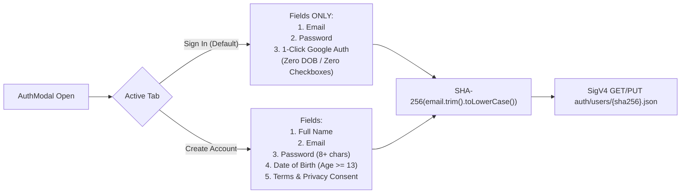

# LIPSYNCER — Security, Cryptography & Privacy Specification
**Elder 4 (Aegis) · Wave 1 Security Hardening Blueprint**

---

## 1. Streamlined Authentication Modal Architecture

LIPSYNCER enforces the **Streamlined Auth Modal Architecture** (`AuthModal.tsx`), eliminating form validation friction while maintaining cryptographic credential integrity.



### 1.1 Strict Tab Isolation Rules
- **Sign In Tab:** Renders **strictly** `Email`, `Password`, and the optional `Continue with Google` button. Date of Birth inputs, Full Name inputs, and Consent checkboxes are **unmounted** (not hidden with CSS `required` attributes) so HTML5 form validation never traps returning users.
- **Create Account Tab:** Collects `Full Name`, `Email`, `Password`, `Date of Birth` (verifying minimum age compliance), and an explicit `Terms & Privacy` consent checkbox (`consentAccepted: true` + ISO `consentAcceptedAt` audit timestamp).
- **Instant Tab Switching:** Switching between `Sign In` and `Create Account` immediately clears error banners and loading spinners while preserving any typed `email` value.

---

## 2. Cryptographic Identity & Credential Hashing (Web Crypto API)

All user cryptography executes natively via `window.crypto.subtle` with zero third-party crypto bundles.

### 2.1 Deterministic Email Vault Keying
1. Normalize email: `const canonicalEmail = rawEmail.trim().toLowerCase();`
2. Compute SHA-256 digest:
   ```ts
   const digest = await crypto.subtle.digest('SHA-256', new TextEncoder().encode(canonicalEmail));
   const emailSha256 = Array.from(new Uint8Array(digest)).map(b => b.toString(16).padStart(2, '0')).join('');
   const uid = `usr_${emailSha256.slice(0, 20)}`;
   ```
3. R2 User Document Key: `auth/users/${emailSha256}.json` (prevents PII/email leakage in bucket listings).

### 2.2 Salted PBKDF2-HMAC-SHA256 Password Verification
- **Account Creation:**
  1. Generate a 16-byte cryptographic salt: `crypto.getRandomValues(new Uint8Array(16))`.
  2. Derive a 256-bit key via `PBKDF2` (`hash: 'SHA-256'`, `iterations: 100_000`).
  3. Store `passwordSaltHex` and `passwordHashHex` inside `R2UserVaultRecord`.
- **Sign In Verification:**
  1. Fetch `auth/users/${emailSha256}.json`.
  2. Re-derive PBKDF2 digest using stored `passwordSaltHex` and compare in constant-length byte loop.
  3. **Invariant:** Plaintext passwords and `passwordHashHex` are **never** persisted to `localStorage` (`lipsyncer_auth_session_v1` stores only `uid`, `email`, `displayName`, and `loginAt`).

---

## 3. Web Crypto AWS Signature V4 Presigning for Cloudflare R2

`src/services/r2VaultService.ts` generates short-lived (`X-Amz-Expires=900` — 15 minutes) presigned URLs using browser-native `HMAC-SHA256`:

1. **Key Path Whitelist Guard (Anti-Traversal):**
   Every R2 operation validates the target key before signing:
   - Auth Store: `/^auth\/users\/[a-f0-9]{64}\.json$/`
   - Video Vault: `/^users\/usr_[a-f0-9]{20}\/videos\/[a-zA-Z0-9_-]{4,64}\.mp4$/`
   - Manifest/Storyboard: `/^users\/usr_[a-f0-9]{20}\/(manifests|storyboards)\/[a-zA-Z0-9_-]{4,64}\.json$/`
   Any key containing `..`, `\`, leading `/`, or non-matching segments throws an immediate `SecurityViolationError`.
2. **Canonical Signing Chain:**
   - `kDate = HMAC_SHA256("AWS4" + secretAccessKey, yyyymmdd)`
   - `kRegion = HMAC_SHA256(kDate, "auto")`
   - `kService = HMAC_SHA256(kRegion, "s3")`
   - `kSigning = HMAC_SHA256(kService, "aws4_request")`
   - `signature = HEX(HMAC_SHA256(kSigning, stringToSign))`
3. **Unsigned Payload Header:** Uses `X-Amz-Content-Sha256=UNSIGNED-PAYLOAD` in query parameters for streaming large MP4 `Blob` uploads without double-buffering multi-hundred-MB buffers in memory.

---

## 4. Zero Hardcoded Secrets & `.env` Isolation

1. **Source Code Cleanliness:** Zero `hf_*`, `sk-*`, `AIza*`, R2 access keys, or Firebase private credentials may ever appear in `src/**`, `public/**`, `index.html`, or `build-ssg.js`.
2. **Environment Contract:** All build/runtime secrets reside strictly in `.env` (listed in `.gitignore`), documented via placeholder-only `.env.example`.
3. **Token Masking in UI:** `TokenPoolModal.tsx` masks every Hugging Face token as `hf_••••••${token.slice(-4)}` and never logs full tokens to `console.log` or error toasts.

---

## 5. CORS-Safe Local `blob:` Isolation (Anti-Tainted Canvas Guard)

HTML5 `<canvas>` (`lipsyncer-dsp-60fps` and 4K Veo restoration passes) throws `SecurityError: Failed to execute 'captureStream' / 'toBlob' on 'HTMLCanvasElement': Tainted canvases may not be exported` if any cross-origin image or video frame lacks strict CORS headers.

LIPSYNCER enforces **Mandatory Local Blob Isolation**:
1. Remote assets returned by Hugging Face Spaces, SiliconFlow, Zhipu CogView-3, or Cloudflare R2 are **never** bound directly by remote URL to `<canvas>` or `AudioContext.createMediaElementSource()`.
2. Assets are ingested first via `fetch(remoteUrl)` -> `response.blob()`, persisted into IndexedDB `lipsyncer_media_vault`, and mounted exclusively via same-origin `URL.createObjectURL(blob)` (`blob:https://lipsyncer.web.app/...`).
3. Every `URL.createObjectURL` handle is tracked by a scoped registry and deterministic `URL.revokeObjectURL()` cleanup runs on component unmount or render replacement to prevent memory leaks.

---

## 6. HTTP Security & Content-Security-Policy Headers

Configured in `firebase.json` across all routes:

| Header | Value |
| :--- | :--- |
| `X-Frame-Options` | `SAMEORIGIN` |
| `X-Content-Type-Options` | `nosniff` |
| `Referrer-Policy` | `strict-origin-when-cross-origin` |
| `Permissions-Policy` | `camera=(self), microphone=(self), geolocation=()` |
| `Cross-Origin-Opener-Policy` | `same-origin-allow-popups` |
| `Content-Security-Policy` | `default-src 'self'; script-src 'self' 'unsafe-inline' https://www.gstatic.com https://www.googletagmanager.com https://pagead2.googlesyndication.com; style-src 'self' 'unsafe-inline' https://fonts.googleapis.com; font-src 'self' https://fonts.gstatic.com data:; img-src 'self' data: blob: https:; media-src 'self' data: blob: mediastream: https:; connect-src 'self' blob: https://*.hf.space wss://*.hf.space https://huggingface.co https://*.r2.cloudflarestorage.com https://*.r2.dev https://api.siliconflow.cn https://open.bigmodel.cn https://generativelanguage.googleapis.com https://relay.modelissa.com https://*.googleapis.com https://*.google-analytics.com; worker-src 'self' blob:; frame-ancestors 'self';` |
