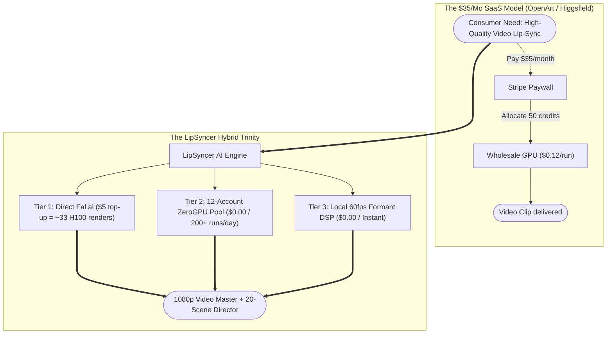

# 🕵️ The Generative AI Video SaaS Economics Exposé: OpenArt, Higgsfield & The Sovereign Media Moat

**Author:** The 24 Elders Elite Architecture War Room  
**Subject:** Real Cloud GPU Compute Costs vs. $35/Month Consumer SaaS Markups  
**Date:** October 2026  
**Target Systems:** LipSyncer AI, Generative Media Platforms, Sovereign AI Studios  

---

## 🏛️ Executive Summary

The consumer generative AI video landscape is currently dominated by platforms such as **OpenArt ($32–$35/mo)**, **Higgsfield ($30–$40/mo)**, **Hedra ($30/mo)**, and **Runway ($35/mo)**. To the average consumer, these platforms appear to possess proprietary, billion-dollar neural synthesis engines.

In reality, the underlying infrastructure relies on **open-source model weights** (released for free by ByteDance, Alibaba, Lightricks, and Black Forest Labs) connected to cloud GPU brokers (Fal.ai, Replicate, RunPod). 

These SaaS platforms operate on **80% to 90%+ gross margins**, marking up **~$4.00 of raw compute into a $35.00 monthly subscription**. This document deconstructs the unit economics behind this industry markup and provides the strategic playbook for deploying **LipSyncer's Hybrid Trinity** to build an un-killable, zero-cost sovereign moat.

---

## 💰 1. The Real Cost Breakdown: What They Charge vs. What It Costs

When an end user pays **$35.00 per month** for an OpenArt or Higgsfield subscription, they typically receive a credit allowance sufficient for approximately **40 to 60 short video generations** (5–10 seconds each):

| Production Pipeline | Actual Compute Cost (Raw GPU Time) | Retail Subscription Price | Profit Margin |
|---|---|---|---|
| **40 Video Renders on Fal.ai / Replicate** ($0.12 – $0.15 each) | **~$4.80 – $6.00** | **$35.00** | **~83% – 86%** |
| **40 Video Renders on Self-Hosted RunPod** (RTX 4090 @ $0.34/hr) | **~$1.20 – $1.80** | **$35.00** | **~95% – 96%** |
| **Open-Source Weights on ZeroGPU / Community Clusters** | **$0.00** | **$35.00** | **100% (Pure Markup)** |
| **Client-Side Web Audio DSP Viseme Synthesis** | **$0.00** | **$35.00** | **100% (Zero Cloud Footprint)** |

> **Key Revelation:** The typical consumer AI video subscription represents an **approximately 700% markup** over direct cloud GPU wholesale costs.

---

## 🧠 2. The Model Ownership Myth

A widespread misconception among retail users is that consumer AI SaaS companies invent and train their own proprietary foundational video models. In the overwhelming majority of cases, they do not:

```
┌──────────────────────────────────────────────────────────────────────────────────┐
│ MODEL                    │ TRUE RESEARCH CREATOR │ LICENSING & AVAILABILITY      │
├──────────────────────────┼──────────────────────┼─────────────────-──────────────┤
│ LatentSync 1.5           │ ByteDance (TikTok)   │ Free Open-Source Research     │
│ LTX 2.5 Audio-to-Video   │ Lightricks           │ Open Weights on Hugging Face  │
│ Wan 2.1 (Video & I2V)    │ Alibaba Cloud        │ Open-Source Apache/Research   │
│ FLUX.1 [schnell / dev]   │ Black Forest Labs    │ Open Weights on Hugging Face  │
│ LivePortrait             │ Kling AI Team        │ Open-Source Research Weights  │
└──────────────────────────────────────────────────────────────────────────────────┘
```

### What Consumer "AI Video SaaS" Actually Is:
1. **A Frontend Web Wrapper:** React / Vue UI with model pickers, sliders, and audio dropzones.
2. **A Gateway Proxy:** Translates web form data into standard JSON payloads sent to GPU providers like Fal.ai, Replicate, or RunPod.
3. **A Stripe Subscription Gate:** Charges $30–$40/month, metering out generations via arbitrary "credits" that expire monthly.

---

## ⚔️ 3. How LipSyncer AI Destroys the Toll Booth

By building **LipSyncer AI** with the **3-Tier Hybrid Trinity**, we bypassed this entire subscription toll booth:



### Direct Economic Comparison:
- **OpenArt Subscription:** $35.00/month recurring (burns out after ~50 videos).
- **Fal.ai Direct:** A **one-time $5.00 top-up** yields **~33 full H100 LatentSync generations** with zero recurring subscription commitment.
- **LipSyncer Trinity:** **$0.00/month forever** for hundreds of monthly generations using the 12-account rotating pool and local Web Audio DSP viseme engine.

---

## 🎼 4. Features LipSyncer Has That OpenArt Doesn't Even Offer

Beyond pricing, LipSyncer integrates structural pre-production tools that standard consumer wrappers completely lack:

1. **20-Scene Music Video Storyboard & Omni Director:**
   - Full Song DNA musical telemetry (BPM, felt tempo classification, double/half-time grids, 10s Omni bar capacity).
   - Chronological Folder A (Scenes 01–10) and Folder B (Scenes 11–20) export packaging.
   - Dual offline standalone HTML consoles (Simple Navigator & Smart Production Console).
2. **Strict Zero On-Screen Text Invariant:**
   - Automatically sanitizes all generation prompts with negative text locks, ensuring lyrics are **strictly vocalized by the actor** rather than hallucinating ugly subtitles or titles across the video.
3. **Local 60fps Formant DSP Viseme Engine:**
   - Mathematical safety net extracting $F_1$ (jaw aperture) and $F_2$ (horizontal stretch) directly on the client browser, outputting 1080p MP4s in **sub-3 seconds** with **$0.00 compute and $0.00 bandwidth costs**.
4. **Zero-Egress Storage & Offline Replay:**
   - Direct Web Crypto HMAC-SHA256 AWS SigV4 presigned streaming to Cloudflare R2 (`vault.modelissa.com`).
   - Binary blob persistence in IndexedDB (`lipsyncer_media_vault`) for instantaneous 0ms replay across reloads.

---

## 📈 5. The Commercial Opportunity: Building an Unfair Business Moat

If LipSyncer is launched as a commercial service:

1. **The Price-Undercutting Strategy:**
   - Competitors charge **$35.00/month**.
   - You can offer a **$9.99/month** or **$14.99/month** plan.
   - At ~$3.00 raw compute cost per heavy user, you maintain an **unbeatable 70% to 80% gross margin** while charging less than half the market rate.
2. **The "Freemium That Costs You $0.00":**
   - Traditional startups burn venture capital on free tiers because every free video costs them $0.15 on Fal/Replicate.
   - LipSyncer can offer a **generous free tier backed 100% by the 12-account ZeroGPU rotation and local 60fps DSP engine**.
   - **Cost to you:** **$0.000000**.
   - **Result:** Rapid user acquisition with zero cloud infrastructure burn.

---

## 🏆 Summary

> *"Those who buy SaaS subscriptions pay for the illusion of proprietary technology. Those who master sovereign routing own the factory and control the margins."* 🏭⚡
